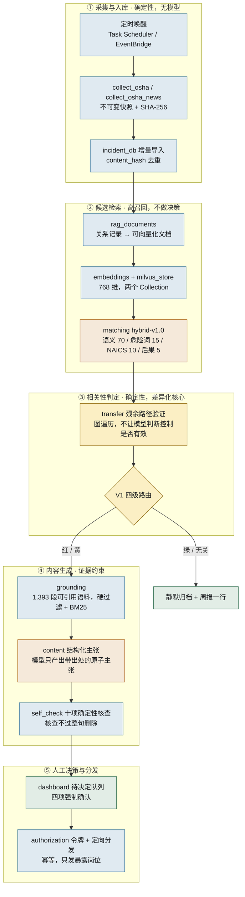

<div align="center">

# Hindsight Safety Agent

**把别人工厂已经发生的事故，变成你工厂明天开班前的一页纸——每一句都能点回原文。**

[](https://github.com/YOUR-ORG/hindsight-agent/actions/workflows/tests.yml)
[](https://www.python.org/)
[](LICENSE)
[](#测试)
[](#测试)
[](https://strandsagents.com/)

[快速开始](#60-秒跑通) · [它怎么工作](#系统怎么工作) · [五条铁律](#五条铁律和它们的代码位置) · [实测数字](#实测数字) · [文档](#文档索引) · [常见问题](#常见问题)

</div>

---

## 一句话

OSHA 每天公布美国各地的严重伤害事故。其中绝大多数与你的工厂无关，少数几条描述的
正是你车间里那台机器、那道工序、那个已经登记在册却迟迟没关闭的风险。

Hindsight 每天读完这些事故，用**确定性代码**（不是模型）判断哪几条真的落在你自己的
风险登记册上，然后为这几条起草一份带出处的简报和双语班前会，交给安全经理审批。
未经人批准，任何内容都不会触达工人。

> **相关度是检索证据分数，不是事故发生概率，也不自动下达安全指令。**

<div align="center">

| 输入 | 处理 | 输出 |
|:---:|:---:|:---:|
| 105,996 条 OSHA 事故<br>1,393 段 29 CFR / Fatal Facts | 确定性硬过滤 → 残余路径验证<br>→ 证据约束生成 → 十项自检 | 4 条待审批<br>每句可点回原文 |

</div>

---

## 目录

- [60 秒跑通](#60-秒跑通)
- [它解决什么问题](#它解决什么问题)
- [系统怎么工作](#系统怎么工作)
- [五条铁律和它们的代码位置](#五条铁律和它们的代码位置)
- [实测数字](#实测数字)
- [安装](#安装)
- [配置模型](#配置模型)
- [命令速查](#命令速查)
- [业务控制台](#业务控制台)
- [数据边界与明确不做的事](#数据边界与明确不做的事)
- [项目结构](#项目结构)
- [测试](#测试)
- [文档索引](#文档索引)
- [常见问题](#常见问题)
- [路线图](#路线图)
- [许可与致谢](#许可与致谢)

---

## 60 秒跑通

前提：Python 3.10+，以及一个 OpenAI 兼容的模型端点（LM Studio / vLLM / SGLang /
Ollama / 自建网关皆可）。**不需要 Docker，不需要 Milvus，不需要 Ollama。**

```bash
git clone <你的仓库地址> && cd Hindsight-Agent

# 1. 环境 + 虚拟工厂 + 事故底库 + 接地语料，全程幂等
./scripts/setup_local.sh                  # macOS / Linux
# .\scripts\setup_local.ps1               # Windows PowerShell

# 2. 指向你的模型
cp .env.example .env
#   HINDSIGHT_MODEL_PROVIDER=openai
#   OPENAI_BASE_URL=http://127.0.0.1:1234/v1
#   OPENAI_MODEL_ID=<你的模型标识>

# 3. 一条命令跑通全流程
.venv/bin/hindsight-demo --reset

# 4. 打开控制台审批
.venv/bin/hindsight-dashboard
```

实际输出：

```text
前置检查
  代码 · /path/to/Hindsight-Agent/src/hindsight_agent
  项目根 · /path/to/Hindsight-Agent
  事故库 · /path/to/Hindsight-Agent/data/incidents/incidents.db
  数据就绪 · 事故 105,996 条 · 语料 1,393 段
  模型可达 · gemma-2-9b-it @ http://127.0.0.1:1234/v1 （0.45s）
  上下文 · 4096 token（服务端上报）· 提示词 2228 / 回答 1228
  提示 · 窗口偏小，本项目会自动少放语料以装得下。

运行工作流 W1→D5

结果
  考察 · 500 条外部事故
  确定性归档 · 496 条（每条都有理由码）
  抽取隔离 · 0 条
  进入人工队列 · 4 条　分级 {'RED': 4, 'YELLOW': 0}
  已起草待审批 · 3 条
  G4 自检 · 检查 22 条主张，删除 0 条，存活率 100%

  本周扫描后静默归档 496 条，需要你决定 4 条。

下一步：hindsight-dashboard   打开控制台，在「待你决定」里审批
```

**「G4 自检」是换模型之后第一个该看的数字。** 自检把没有出处的主张整句删掉，所以
一个弱模型的典型表现不是「写错了」，而是「写完之后基本被删光」。存活率比任何主观
评价都更快地告诉你这个模型够不够用。

常用参数：

| 参数 | 作用 |
|---|---|
| `--skip-model` | 只跑筛选与路由，完全不调模型（先看确定性部分） |
| `--as-of YYYY-MM-DD` | 固定控制有效期基准日，结果可复现 |
| `--draft-limit N` | 最多起草几条（每条调一次模型） |
| `--reset` | 先清工作流状态再跑。**只清案例与投递，绝不动事故底库与语料** |
| `--out result.json` | 把完整结果写成 JSON |

---

## 它解决什么问题

安全经理知道「从别人的事故里学习」是对的。真正拦住这件事的从来不是意愿：

| 现实困难 | Hindsight 的处理 |
|---|---|
| OSHA 每批上万条，人工筛不动 | 确定性硬过滤先剔掉 87.2%，3 秒，零模型调用 |
| 「相关」很主观，读十条有九条不相关 → 关掉不看 | 相关性由**本厂自己的风险登记册**判定，不由模型的语感判定 |
| 让 LLM 写培训材料，读起来很顺，但数字是编的 | 每条主张必须带出处；十项确定性核查，数值必须在来源中逐字出现 |
| 一天推送十条，第三天没人再看 | 路径节流 + 每周告警预算，超预算的红降黄进批量确认，**不丢弃** |
| 自动化的东西没人负责 | 未经人批准不触达；批准前四项强制确认；全链路只追加留痕 |

**这个系统的差异化不在于「用了 LLM」，而在于它把判定权从模型手里拿走了。**
全链路只有两处调用模型：向量生成，和主张起草。所有「要不要提醒人」的判定
都是确定性代码，可复现、可解释、可被测试锁定。

---

## 系统怎么工作



蓝＝确定性代码　橙＝用到模型　黄＝差异化核心　绿＝终点

> 完整权威版本见 **[docs/ARCHITECTURE.md](docs/ARCHITECTURE.md)**。仓库里还有几张
> 早期图（`docs/hindsight-workflow.png` 等），用途与时效在架构文档末尾有说明，
> 有冲突以架构文档为准。

### 第 ③ 层：为什么这条事故会到你面前

相关性不由模型判断，由**你自己的登记册**判断。一条危险路径是
`risk_assessments` 的一行：设备 × 任务 × 危险 × 暴露岗位。判定按固定优先级，
第一条命中即生效：

| 序 | 条件 | 结论 |
|---|---|---|
| 1 | `risk_accepted=0`、`status=action_required`，或存在未闭环整改 | **ACTIONABLE** |
| 2 | 该路径未登记任何控制 | **UNKNOWN** |
| 3 | 至少一条控制在截止日仍 VERIFIED | NO_ACTIONABLE_TRANSFER |
| 4 | 至少一条控制从未验证过 | **UNKNOWN** |
| 5 | 其余（全部过期 / 有条件 / 未实施） | **ACTIONABLE** |

规则 1 压过规则 3 是刻意的：一条工厂已声明「未接受」的风险，不能被一个验证合格的
防护罩挡回去。

四级路由：

| 判定 | 严重度 | 级别 | 去向 |
|---|---|---|---|
| ACTIONABLE | ≥ 4 | 🔴 红 | 逐条审批 |
| ACTIONABLE | < 4 | 🟡 黄 | 批量确认 |
| UNKNOWN | 任何 | 🟡 黄 | 请人过目 |
| NO_ACTIONABLE_TRANSFER | 任何 | 🟢 绿 | 静默归档 + 周报一行 |
| 无候选路径 | — | ⚪ 无关 | 静默归档 |

**UNKNOWN 永不进红。** 高严重且无法判定，正是系统不能装作确定的场合——所以
「高严重 × 低置信强制降黄」写成硬规则，而不是一个需要人去解释的置信分数。

### 第 ④ 层：模型只被允许说有出处的话

模型不写段落，只产出**带出处的原子主张**。它拿到的是一个封闭的引用清单，清单之外
的任何 id 都会在 G4 解析失败并被删除。G4 十项核查全部是查表或字符串比对，
不含模型判断：

| 核查 | 拦住什么 |
|---|---|
| `CITATION_PRESENT` | 一句没有任何出处的话 |
| `CITATION_RESOLVES` | 看起来很真的编造 id |
| `CITATION_TYPE` | 拿事故叙述当作「你应该怎么做」的依据 |
| `QUOTE_VERBATIM` | 引号里的话和原文对不上 |
| **`NUMERALS_SUPPORTED`** | **编造的间隙、扭矩、周期——最危险的一类** |
| `BILINGUAL_PRESENT` / `BILINGUAL_NUMERALS` | 西语稿漂移成另一份主张 |
| `CONTROL_VOCABULARY` | 建议一个本厂没批准过的控制措施 |
| `SITE_SCOPE` | 引用了别的站点的记录 |
| `QUIZ_BACKED` | 测验题的依据已经被删了 |

核查不过的**整句删除**，最多重生成一次；仍填不满必需章节则置
`NEEDS_HUMAN_WRITER`，作为写作任务交回给人——**它从不为了凑满而出稿**。

---

## 五条铁律和它们的代码位置

这五条不是文档里的承诺，是有测试锁定的代码属性。
`tests/test_red_team.py` 里的每个测试都是一次**真诚的攻击**，写出来是为了成功；
它们通过，意味着攻击被拒绝。

| 铁律 | 由什么保证 |
|---|---|
| **未批不触达** | `DistributionGuard` 挂在 `BeforeToolCallEvent` 上直接 `cancel_tool`；状态机里没有一条绕过 `APPROVED` 通往 `DISTRIBUTED` 的边；`deliver` 再验一次签 |
| **No Evidence → No Alert** | `self_check` 十项核查，无出处整句删除 |
| **无出处不写** | `learning_pack` 主张契约：模型只能产出带 citation 的原子主张 |
| **重跑幂等** | `open_case` / `deliver` / `send_reminder_record` 三处幂等键 |
| **一切留痕** | `case_transitions` 只追加，自增 `seq` 保证审计链顺序 |

### 安全内核不可通过学习循环修改

系统有一个进化循环（R1–R4）：驳回与阻断会进入信号池，`rule_pack` 会提出
一次只改一处、每条附证据的 diff，由具名的人批准，版本化并可一键回滚。

但 `rule_pack.IMMUTABLE_KEYS` 在代码层拒绝任何触及以下项的提案：

```text
require_evidence_for_every_claim             每条主张必须有出处
require_human_approval_before_distribution   未批不触达
unknown_never_routes_red                     未知永不冒充确定
cross_site_isolation                         跨厂隔离
numerals_must_be_sourced                     数值必须来自来源
```

这是「会学习的系统」与「会漂移的系统」的分界：任何一串被接受的 diff 都不可能
侵蚀这五条。有独立测试锁定。

---

## 实测数字

全部来自本机真实运行，不是估算。

### 数据规模

| 项目 | 数量 |
|---|---:|
| OSHA 严重伤害事故（2015-01-01 → 2025-11-30） | 105,996 |
| OSHA 官方新闻稿 | 5 |
| 接地语料段落（29 CFR 8 节 + Fatal Facts 24 篇，含官方西语版） | 1,393 |
| 语料文档 | 32 |
| 虚拟工厂：设备 / 风险评估 / 控制措施 / 控制验证 | 20 / 97 / 15 / 66 |
| 虚拟工厂：区域 / 作业 / 危险 / 岗位 / 对齐标准 | 6 / 22 / 21 / 12 / 5 |

### 第 ① ② 层：硬过滤

```text
全库 105,996 条 → 通过 13,609，剔除 87.2%，耗时 3.13s，零模型调用

理由码分布：
  INDUSTRY_NOT_NEIGHBOUR   89,905     NAICS 与本厂不邻近
  PASS                     13,609
  NO_SITE_HAZARD_TERM       2,480     本厂危险词表里没有这类危险
  NO_NAICS                      2     没有行业码，不猜
```

**每一条被剔除的都有理由码。** 这是「静默归档」和「悄悄丢掉」的区别。

### 第 ③ 层：97 条危险路径的判定（截止日 2026-09-06）

```text
红 14  黄 1  绿 82  无关 0
需要人看 15 条 · 静默归档 82 条
```

### 端到端：一次 `hindsight-demo --reset`

| 阶段 | 结果 |
|---|---|
| 考察 | 500 条外部事故 |
| 确定性归档 | 496 条（每条带理由码） |
| 进入人工队列 | 4 条，全部 RED（4 条不同危险路径） |
| 起草待审批 | 3 条（`--draft-limit 3`） |
| G4 自检 | 22 条主张，删除 0 条，存活率 100% |
| 批准后送达 | 每条 2 个渠道（英 / 西），幂等键防重复 |

模型：`gemma-2-9b-it`，4096 上下文，本地 LM Studio。

### 工程规模

| 项目 | 数量 |
|---|---:|
| 源码模块 / 行数 | 34 / 12,249 |
| 测试文件 / 行数 | 20 / 4,788 |
| 测试用例 | **236 全部通过** |
| 覆盖率（整体） | 77% |
| 覆盖率（安全内核 `self_check` / `distribution` / `workflow_db`） | 94% / 94% / 93% |

测试不依赖 Docker、Milvus、Ollama 或网络：用内存向量库和确定性 Hash Embedding。

---

## 安装

### macOS / Linux

```bash
./scripts/setup_local.sh                  # 演示路径需要的一切
./scripts/setup_local.sh --with-vectors   # 再加 Milvus / Ollama / 向量回填
./scripts/setup_local.sh --skip-data      # 已经有数据，只装环境
./scripts/setup_local.sh --help
```

### Windows

```powershell
Set-ExecutionPolicy -Scope Process Bypass
.\scripts\setup_local.ps1
.\scripts\setup_local.ps1 -SkipDocker -SkipModels -BootstrapLimit 0
```

两个脚本都是**幂等**的：已经建好的库不重建，已经采过的语料不重采。

脚本做的事：创建 `.venv` → 安装项目 → 生成中文虚拟工厂 → 采集并导入 OSHA
官方资料 → 采集接地语料。PowerShell 版还会启动 Milvus/Jaeger、拉取 Ollama 模型、
为最近 200 条事故建立向量索引；这些在 shell 版里放在 `--with-vectors` 后面，
因为 `hindsight-demo` 不需要它们。

### 接地语料（内容生成必需，一次性）

安装脚本已包含。单独重跑：

```bash
hindsight-grounding-collect                     # 29 CFR + Fatal Facts，约 3 分钟
hindsight-grounding-collect --cfr-only          # 只要法规
hindsight-grounding-collect --face-dir ./face   # 另加手工放置的 NIOSH FACE
```

**不跑这一步，内容生成会因为没有可引用来源而拒绝出稿。** `data/` 不进版本库，
所以每台机器都要各跑一次。

### 手动安装

```bash
python3 -m venv .venv
.venv/bin/python -m pip install -e ".[dev]"
```

可选 extras：`observability`（OTLP exporter）、`dev`（pytest）。

### 作为发行包安装

```bash
python -m build                                   # 生成 dist/*.whl 与 *.tar.gz
pip install dist/hindsight_agent-0.2.0-py3-none-any.whl
```

装成 wheel 之后，18 个 `hindsight-*` 命令在任何目录都可用。此时 `data/` 与
`.env` 的位置**以当前工作目录为准**；想固定到某个目录，设 `HINDSIGHT_HOME`：

```bash
export HINDSIGHT_HOME=/path/to/your/hindsight-workdir
hindsight-demo --reset
```

（从源码检出运行时不需要设它——项目会自己认出仓库根。）

---

## 配置模型

三种 provider，环境变量切换。先把 `.env.example` 复制为 `.env`；应用会自动读取，
**已存在的系统环境变量优先**。

### OpenAI 兼容端点（推荐）

适用于 vLLM、SGLang、LM Studio、Ollama 的 OpenAI 接口、自建网关。

```bash
HINDSIGHT_MODEL_PROVIDER=openai
OPENAI_BASE_URL=http://127.0.0.1:1234/v1
OPENAI_MODEL_ID=gemma-2-9b-it
OPENAI_API_KEY=                      # 没有鉴权就留空
```

这条路径**不要求服务端支持严格 `response_format`**：模型回什么都由本地 Pydantic
校验，解析失败会带着错误重试一次，绝不成环。理由是——真正的保证从来不是「服务端
强制了 schema」，而是「我们校验了收到的东西」。

若你的端点确实支持严格结构化输出，设 `HINDSIGHT_GENERATOR=strands` 切回原生路径。

### 上下文窗口是自动适配的

一次起草的提示词是四位数 token，而本地端点常常默认只装 4096（LM Studio 给
gemma-2-9b 就是这样）。本项目**在发请求之前先问服务端装了多大**，再按这个数字
决定放几段语料、留多少字给模型开口：

- 窗口大就多放语料；
- 窗口小就先保住法规要求条文，让背景叙述和西语语料让位——而不是把语料写死砍短，
  让大模型也跟着变笨；
- 服务端不肯说时按 8192 保守估计；
- 你可以用 `HINDSIGHT_MODEL_CONTEXT` 直接告诉它真实值。

窗口小到连最小证据都放不下时，它会当场说清楚是上下文不够、该改哪个数字，而不是
跑到一半收到一个服务端 400。

> 小窗口能跑通，但稿件会薄。前置检查会把实际窗口打出来；看到「窗口偏小」的提示，
> 用 ≥8192 的上下文重新装载模型，稿件会明显更实。

### Ollama（默认）

```bash
HINDSIGHT_MODEL_PROVIDER=ollama
OLLAMA_HOST=http://localhost:11434
OLLAMA_MODEL_ID=qwen3:4b-instruct-2507-q4_K_M
OLLAMA_EMBED_MODEL=nomic-embed-text-v2-moe
```

### Amazon Bedrock

```bash
HINDSIGHT_MODEL_PROVIDER=bedrock
BEDROCK_MODEL_ID=<模型 id>
```

需要先配好 AWS 凭据与模型访问权限。云端部署见
[docs/AGENTCORE_DEPLOY_ZH.md](docs/AGENTCORE_DEPLOY_ZH.md)。

> **端点写的是「谁能连上」，不是「谁在跑」。** 如果模型跑在你自己的机器上而流程
> 跑在别的环境里（容器、虚拟机、远程会话），`127.0.0.1` 指的是各自的本机——
> 需要先把它暴露成双方都能访问的地址。

---

## 命令速查

| 命令 | 作用 |
|---|---|
| `hindsight-demo` | **一条命令跑通全流程**，停在可审批状态 |
| `hindsight-dashboard` | 中文业务控制台（Streamlit） |
| `hindsight-workflow` | 完整工作流 W1→D5：筛选、判定、路由、归档、队列、提醒、晨报 |
| `hindsight-screen` | 残余路径验证 + 四级路由（红/黄/绿/无关） |
| `hindsight-draft` | 为一条危险路径 + 一条事故生成带出处的简报与双语班前会 |
| `hindsight-collect` | OSHA SIR 确定性采集（不可变快照 + SHA-256） |
| `hindsight-news-collect` | OSHA 官方新闻 RSS 确定性采集 |
| `hindsight-incidents-import` | 快照增量导入 SQLite |
| `hindsight-incidents-show` | 查看事故库摘要 |
| `hindsight-factory-create-zh` | 生成中文标准化虚拟工厂 |
| `hindsight-factory-show` | 查看虚拟工厂层级 |
| `hindsight-grounding-collect` | 采集 29 CFR 与 Fatal Facts 接地语料 |
| `hindsight-rag-bootstrap` | 补齐已有数据的 Milvus 向量 |
| `hindsight-daily` | 完整确定性流水线，不经过 LLM 决策 |
| `hindsight-daily-agent` | Strands Agent 运行完整工具 |

每个命令都支持 `--help`。

### Strands 工具（`rag_agent.build_agent()` 注册 9 个）

| 工具 | 层 | 说明 |
|---|---|---|
| `run_daily_surveillance` | ①② | 跑完整采集与匹配流水线 |
| `screen_factory_risk_paths` | ③ | 残余路径验证 + 四级路由 |
| `collect_grounding_corpus` | ④ | 采集接地语料（一次性） |
| `draft_learning_pack` | ④ | 起草稿件，**返回审计摘要不返回稿件** |
| `get_pending_decisions` | ⑤ | 待人工决定队列 |
| `record_match_decision` | ⑤ | 记录明确的人工决定 |
| `distribute_learning_pack` | ⑥ | 定向分发（受 `DistributionGuard` 保护） |
| `get_completion_status` | ⑥ | 谁读完了、成绩如何 |
| `get_monday_digest` | ⑥ | 周一摘要，安静的一周也照发 |

---

## 业务控制台

```bash
hindsight-dashboard     # 默认 http://localhost:8501
```

六个页签：**待你决定**、风险登记册判定、分发与完成、审计链、候选检索、数据边界。

「待你决定」是核心界面，一条案例的完整决定流程：

1. **外部事故原文** —— 雇主、日期、NAICS、伤害性质、完整叙述、来源键
2. **为什么它到了你面前** —— 残余路径验证证书：哪条控制没能切断、系统作出了哪些
   假设、登记册内部有什么矛盾、还缺哪些关键事实
3. **将要发给一线的内容** —— 英西双语简报与班前会，**每一行都标注出处**
4. **出处原文（逐条核对）** —— 每个引用 id 展开成原文，让第 2 项确认真的可以完成
5. **自检结果（G4）** —— 检查了几条、删了几条、每条删除的原因
6. **批准前的四项强制确认** —— 四项全勾 + 填写具名批准人，按钮才可用

> 第 4 项是有意加的。审批清单要求人「抽查一条引用确实支持该说法」，如果界面只给
> 一个 `corpus:cfr:1910.147#0011` 这样的 id，人就无法在这个界面里完成他签字确认
> 自己做过的那件事。G4 能验证引用解析得到、数值没被编造，但它**验不了一句转述有
> 没有把法规的意思说反**——那件事只有人能做，前提是把原文摆在他面前。

其它服务（`--with-vectors` 时）：Jaeger 轨迹 `http://localhost:16686`，
Attu 向量库界面 `http://localhost:8001`，Milvus `http://localhost:19531`。

---

## 数据边界与明确不做的事

这一节写在这里，是因为它决定了这个系统的结论能被信到什么程度。

### 数据能支撑什么，不能支撑什么

| 事实 | 后果 |
|---|---|
| OSHA SIR 是**批量数据集**，当前批次到 2025-11-30 | demo 采用**历史回放**，不是实时事故流。视频与答辩中必须如实说明 |
| SIR 仅覆盖**联邦 OSHA 管辖范围**，约一半美国劳动者 | 州计划辖区与公共雇员不在内，不能宣称全美覆盖 |
| OSHA 新闻 RSS 是目前唯一的近实时信号，量很小 | 它补充 SIR 的截止日期之后，不构成完整覆盖 |
| 记录条数不是事件发生率 | 没有分母（工时、人数）就不比较行业或州的风险高低 |
| 虚拟工厂是**合成数据**，按 ISO/IEC 概念对齐建模 | 不是任何真实企业的内部资料，也不代表已获 ISO 认证 |

### 相关度分数的定位

```text
relevance = semantic*0.70 + hazard*0.15 + industry*0.10 + consequence*0.05
```

版本 `hybrid-v1.0`，分项与命中词存进 `incident_factory_matches.rationale_json`。

**它是候选检索器，不是决策器。** 分数只影响送进第 ③ 层的候选顺序，不决定是否
提醒人。这条分工是刻意的：权重 70/15/10/5 没有金标准支撑，而召回率是可以验证的。

### 明确不做（Non-Goals）

- 摄像头 / 计算机视觉监控；IoT 传感器接入
- 通用 EHS 平台功能（事故上报、审计、检查表）
- 完整 LMS（课程库、学分、证书）
- 自动处罚、纪律记录、雇主排行榜
- 自主控制建议——任何培训内容未经安全经理批准不得触达工人
- 真实短信 / 邮件渠道（demo 用模拟收件箱，见 `data/outbox/`）

### 不能宣称的成效

系统能证明的是**缩短安全经理检索案例与准备材料的时间**，以及让跨站学习可追溯。
它**不能**在短期内宣称降低事故率——那需要长期、有对照的现场评估。

---

## 项目结构

```text
Hindsight-Agent/
├── src/hindsight_agent/
│   ├── config.py              环境配置（路径、阈值、模型端点）
│   │
│   │   ① 采集与入库
│   ├── tools/collect_osha.py         OSHA SIR 采集，不可变快照 + SHA-256
│   ├── tools/collect_osha_news.py    官方新闻 RSS 采集
│   ├── tools/collect_grounding.py    29 CFR / Fatal Facts / FACE 语料采集
│   ├── incident_db.py                事故库 schema 与增量导入
│   ├── corpus_db.py                  接地语料库 schema
│   ├── factory_db.py                 标准化虚拟工厂生成（对齐 5 项 ISO/IEC）
│   │
│   │   ② 候选检索
│   ├── rag_documents.py              关系记录 → 可向量化文档
│   ├── embeddings.py                 Ollama / Hash 两种 embedding provider
│   ├── milvus_store.py               向量库封装（可注入内存实现）
│   ├── matching.py                   hybrid-v1.0 混合评分 + 危险词表
│   │
│   │   ③ 相关性判定 ★ 差异化核心
│   ├── screening.py                  抽取置信度 · 硬过滤 · 静默归档
│   ├── transfer.py                   残余路径验证 + 四级路由
│   ├── rule_pack.py                  规则包版本化 + 不可变安全内核
│   │
│   │   ④ 内容生成
│   ├── grounding.py                  硬过滤 + BM25 检索，产出证据包
│   ├── content.py                    结构化生成 · 上下文预算 · G1→G4 编排
│   ├── learning_pack.py              主张契约与双语渲染
│   ├── self_check.py                 十项确定性核查
│   │
│   │   ⑤ 决策与分发
│   ├── workflow_db.py                案例状态机 + 九张治理表
│   ├── authorization.py              HMAC 令牌 + DistributionGuard hook
│   ├── distribution.py               渠道注册 · 定向分发 · 提醒 · 晨报
│   ├── workflow.py                   总编排 W1→D5
│   ├── dashboard.py                  Streamlit 中文业务控制台
│   ├── demo.py                       一条命令跑通全流程
│   │
│   ├── rag_agent.py                  Strands Agent 与 9 个工具
│   ├── daily_pipeline.py             确定性日常流水线
│   └── seed/                         虚拟工厂种子数据（含中文翻译）
│
├── tests/                     20 个文件 · 236 个用例
│   ├── test_red_team.py              五条铁律的攻击测试
│   ├── test_model_context.py         上下文预算与提示词裁剪
│   ├── test_hazard_vocabulary.py     危险词表精度
│   ├── test_distribution_coverage.py 渠道覆盖漂移守卫
│   ├── test_project_root.py          安装后的数据路径解析
│   └── ...
│
├── docs/                      架构、工作流对照、内容生成、部署、交接
├── scripts/
│   ├── setup_local.sh                macOS / Linux 一键准备
│   ├── setup_local.ps1               Windows 一键准备
│   └── register_daily_task.ps1       注册每日定时任务
├── data/                      不进版本库，由采集脚本生成
└── docker-compose.yml         Milvus + etcd + MinIO + Attu + Jaeger
```

---

## 测试

```bash
pytest                                    # 236 个用例，约 10 秒
pytest --cov=hindsight_agent --cov-report=term
pytest tests/test_red_team.py -v          # 只跑铁律攻击测试
```

测试**不依赖** Docker、Milvus、Ollama 或网络：用内存向量库和确定性 Hash Embedding。
生产与演示路径始终使用真实组件。

几个值得单独看的测试文件：

| 文件 | 它锁住什么 |
|---|---|
| `test_red_team.py` | 伪造/借用/重放/过期令牌、状态机旁路、编造数值、跨站引用、翻译漂移、重复投递、消失的转移——每一个都是写来成功的攻击 |
| `test_dashboard_app.py` | 用真实 Streamlit runtime 启动控制台。「打开就崩」在这里崩，不在评委面前崩 |
| `test_model_context.py` | 提示词必须装得进模型真正的上下文窗口 |
| `test_distribution_coverage.py` | 渠道表与风险登记册的岗位 id 必须对得上 |
| `test_project_root.py` | 装成 wheel 之后 `data/` 还找得到——这条在源码检出里看不见 |
| `test_end_to_end.py` | 从原始事故一路跑到投递，真的走 HTTP |

CI 在每次 push 与 PR 上跑 `pytest`（见 `.github/workflows/tests.yml`）。

---

## 文档索引

| 文档 | 内容 |
|---|---|
| [docs/ARCHITECTURE.md](docs/ARCHITECTURE.md) | **架构唯一权威版本**：分层、判定契约、数据边界、Strands 工具、批准与分发 |
| [docs/WORKFLOW_29_ZH.md](docs/WORKFLOW_29_ZH.md) | 29 个功能点（S1–S4 / W1–W6 / G1–G4 / A1–A3 / D1–D5 / R1–R4）逐条落地对照与兜底 |
| [docs/G1_G4_CONTENT_ZH.md](docs/G1_G4_CONTENT_ZH.md) | 内容生成实现说明：语料采集、主张契约、十项核查 |
| [docs/AGENTCORE_DEPLOY_ZH.md](docs/AGENTCORE_DEPLOY_ZH.md) | Amazon Bedrock AgentCore 部署步骤 |
| [docs/TEAMMATE_HANDOFF_ZH.md](docs/TEAMMATE_HANDOFF_ZH.md) | 队友交接：数据库怎么连、看哪几张视图 |
| [DATABASE_DICTIONARY_ZH.md](DATABASE_DICTIONARY_ZH.md) | 全部数据表与字段的中文数据字典 |
| [STANDARD_ALIGNMENT_ZH.md](STANDARD_ALIGNMENT_ZH.md) | 虚拟工厂与 ISO/IEC 标准的概念对齐说明 |
| [docs/COMPETITION_SUBMISSION_ZH.md](docs/COMPETITION_SUBMISSION_ZH.md) | 比赛提交检查表 |

### 数据存在哪里

| 数据 | 位置 |
|---|---|
| OSHA 原始 ZIP / CSV / XML / JSONL | `data/raw/` |
| 事故库、运行日志、匹配、案例状态机、投递 | `data/incidents/incidents.db` |
| 接地语料（快照 + 可引用段落） | `data/corpus/grounding.db` |
| 中文 / 英文标准化虚拟工厂 | `data/factory/factory_zh.db` · `factory.db` |
| 模拟收件箱（工人实际收到的东西） | `data/outbox/mock_inbox.jsonl` |
| Milvus 实体数据 | `volumes/milvus/` |

Navicat 可以直接打开 `incidents.db`。中文视图：`待人工决定`、`事故工厂匹配`、
`每日运行`、`事故记录`、`官方公告`。

---

## 常见问题

<details>
<summary><b>起草时报 400，说 context overflow</b></summary>

本项目会先问服务端上下文有多大再裁剪提示词。若服务端上报的数字不准（有些网关会
报模型上限而不是实际装载值），用环境变量直接告诉它真实值：

```bash
HINDSIGHT_MODEL_CONTEXT=8192
```
</details>

<details>
<summary><b>G4 存活率很低，主张被大量删除</b></summary>

存活率低通常意味着模型在编造引用。三个方向：

1. **看删除原因**。`hindsight-demo` 会打印分布。`NUMERALS_SUPPORTED` 多 = 模型在编
   数字；`CITATION_RESOLVES` 多 = 在编 id；`CONTROL_VOCABULARY` 多 = 在建议本厂
   没批准的控制措施。
2. **换更强的模型**，或**加大上下文窗口**（小窗口下语料放得少，模型可引用的东西就少）。
3. **检查语料是否覆盖了这条危险路径**——`hindsight-grounding-collect` 只下载了 8 节
   29 CFR，冷门危险可能确实没有可引用来源。这时系统拒绝出稿是正确行为。
</details>

<details>
<summary><b>批准之后提示「已批准但没有送达任何人」</b></summary>

`APPROVED_BUT_NO_CHANNEL`：这条危险路径的暴露岗位没有注册任何渠道。系统**刻意不
退回全厂广播**——广播正是定向分发要避免的那件事。在
`distribution.DEFAULT_CHANNELS` 里为该岗位登记渠道即可。

`tests/test_distribution_coverage.py` 会检查渠道表覆盖了登记册暴露的每一个岗位
（英西双语），所以这个问题不会静默漂移。
</details>

<details>
<summary><b>采集 OSHA 报 403</b></summary>

osha.gov 的边缘防护会拒绝不带 Mozilla 记号的 User-Agent。本项目使用爬虫惯用的
`Mozilla/5.0 (compatible; Hindsight-Agent/0.2; +<url>)` 写法——如实自报家门，
只是把过滤器要求的记号带上。若仍被拒，通常是网络环境问题（代理、地区限制）。
</details>

<details>
<summary><b><code>hindsight-demo</code> 说这一批全部处理过了</b></summary>

W3 Case Memory 是幂等的：处理过的事故不会重开案例、不重复打扰。要重新演示一遍，
加 `--reset`——它只清工作流状态（案例、转移、投递），**绝不动**事故底库与接地语料。
</details>

<details>
<summary><b>控制台打不开 / 打开是空的</b></summary>

控制台在数据库还不存在时也必须显示空界面而不是 traceback（有测试锁定）。若确实
报错，先确认 `.env` 里的 `HINDSIGHT_INCIDENT_DB` / `HINDSIGHT_FACTORY_DB` 指向了
存在的文件，再跑一次 `hindsight-demo --skip-model` 生成案例。
</details>

<details>
<summary><b>没有 Docker 可以用吗</b></summary>

可以。`hindsight-demo`、`hindsight-workflow`、`hindsight-screen`、`hindsight-draft`、
`hindsight-dashboard` 全部不需要 Milvus——候选检索会回落到基于本厂危险词表的确定性
检索器。Docker 只有在你想用向量粗排（`hindsight-daily` / `hindsight-rag-bootstrap`）
时才需要。
</details>

---

## 路线图

当前实现覆盖 Notion《功能工作流 V1.0》的 29 个功能点，**P0 共 22 个全部落地**。

下一阶段的 44 节点 8 层蓝图见 [docs/roadmap-44-nodes.svg](docs/roadmap-44-nodes.svg)。
主要方向：

- 多站点部署与跨站学习（跨站隔离已是内核保证，尚缺聚合视图）
- 真实分发渠道（当前是模拟收件箱）
- 进化循环的长期评估：规则包 diff 的接受率与误报率追踪
- 更多接地语料来源（NIOSH FACE 已有适配器，需手工放置文件）

---

## 许可与致谢

[Apache License 2.0](LICENSE)

**没有重复造的轮子：**

| 能力 | 使用的成熟组件 | 本项目只实现的部分 |
|---|---|---|
| Agent 循环与工具调用 | Strands `Agent`、`@tool` | 安全边界与工具输入输出 |
| 本地 LLM | Strands Ollama provider / OpenAI SDK | Hindsight 系统提示词与上下文预算 |
| 向量生成 | Ollama `/api/embed` | 事故/工厂文档结构与版本状态 |
| 向量索引和检索 | `pymilvus` + Milvus AUTOINDEX/COSINE | 两个 Collection 的数据契约 |
| 运行轨迹 | Strands OpenTelemetry + Jaeger | 服务名和本地 Compose 配置 |
| 业务控制台 | Streamlit | 待决定队列和证据展示 |
| 云运行 | Amazon Bedrock AgentCore（可选） | 环境变量和部署接入说明 |

`strands-agents-tools` 社区包没有默认安装：它的 `retrieve` 工具面向 Bedrock
Knowledge Bases，不适用于本项目的 Milvus；通用 RSS 工具也不包含本项目所需的官方
域名限制、不可变原文快照和哈希审计。以后确需社区工具时必须使用 `>=0.8.3`。

**数据来源：** 美国职业安全与健康管理局（OSHA）严重伤害报告、官方新闻稿、
Fatal Facts；电子版联邦法规（eCFR）29 CFR。均为公开政府资料。

---

<div align="center">

**相关度是检索证据分数，不是事故发生概率。**<br>
**任何内容未经安全经理批准，不会触达任何一名工人。**

</div>
