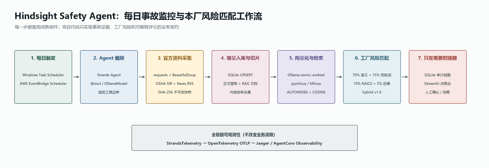

# Hindsight Safety Agent

Hindsight 是一个使用 **Strands Agents SDK** 的后台工业安全 Agent。它每天检查 OSHA
官方事故资料，只增量处理新增或更新的记录，写入 SQLite，使用 Ollama 生成多语言向量，
存入 Milvus，并与本厂标准化风险登记册匹配。只有超过阈值的匹配才进入人工决定队列。

相关度是检索证据分数，不是事故发生概率，也不自动下达安全指令。



## 数据边界与明确不做的事

这一节写在前面，是因为它决定了这个系统的结论能被信到什么程度。

### 数据能支撑什么，不能支撑什么

| 事实 | 后果 |
|---|---|
| OSHA SIR 是**批量数据集**，当前批次到 2025-11-30 | demo 采用**历史回放**，不是实时事故流。视频与答辩中必须如实说明 |
| SIR 仅覆盖**联邦 OSHA 管辖范围**，约一半美国劳动者 | 州计划辖区与公共雇员不在内，不能宣称全美覆盖 |
| OSHA 新闻 RSS 是目前唯一的近实时信号，量很小 | 它补充 SIR 的截止日期之后，不构成完整覆盖 |
| 记录条数不是事件发生率 | 没有分母（工时、人数）就不比较行业或州的风险高低 |
| 虚拟工厂是**合成数据**，按 ISO/IEC 概念对齐建模 | 不是任何真实企业的内部资料，也不代表已获 ISO 认证 |

### 相关度分数的定位

`hybrid-v1.0` 分数是**候选检索的证据分**，不是事故发生概率、不是合规结论、
不是自动行动指令。是否需要人来决定，由第 ③ 层的残余路径验证判定，不由分数判定。

### 明确不做（Non-Goals）

- 摄像头 / 计算机视觉监控；IoT 传感器接入
- 通用 EHS 平台功能（事故上报、审计、检查表）
- 完整 LMS（课程库、学分、证书）
- 自动处罚、纪律记录、雇主排行榜
- 自主控制建议——任何培训内容未经安全经理批准不得触达工人
- 真实短信 / 邮件渠道（demo 用模拟收件箱，见 `data/outbox/`）

### 不能宣称的成效

系统能证明的是**缩短安全经理检索案例与准备材料的时间**，以及让跨站学习可追溯。
它**不能**在短期内宣称降低事故率——那需要长期、有对照的现场评估。

## 已实现工作流

```text
Windows Task Scheduler / EventBridge Scheduler
                     |
                     v
             Strands Hindsight Agent
                     |
                     v
        官方 OSHA SIR + News RSS 采集
                     |
           不可变快照 + SHA-256 去重
                     |
                     v
         SQLite 增量导入 + 新闻正文提取
                     |
                     v
       Ollama multilingual embedding (768d)
                     |
                     v
          Milvus incidents / factory_risks
                     |
                     v
      语义 + 危险词 + NAICS + 后果混合评分
                     |
                     v
       SQLite 审计表 + 人工决定队列 + 控制台
```

> 上图只画到「匹配 + 人工队列」，是项目早期的形态。**当前完整架构以
> [docs/ARCHITECTURE.md](docs/ARCHITECTURE.md) 为准**，它多出两层：残余路径验证与
> 四级路由（第 ③ 层）、证据约束的内容生成（第 ④ 层）。

可编辑源文件：[docs/HINDSIGHT_WORKFLOW.excalidraw](docs/HINDSIGHT_WORKFLOW.excalidraw)。

## 没有重复开发什么

| 能力 | 使用的成熟组件 | 本项目只实现的部分 |
|---|---|---|
| Agent 循环与工具调用 | Strands `Agent`、`@tool` | 安全边界与工具输入输出 |
| 本地 LLM | Strands Ollama provider | Hindsight 系统提示词 |
| 向量生成 | Ollama `/api/embed` | 事故/工厂文档结构与版本状态 |
| 向量索引和检索 | `pymilvus` + Milvus AUTOINDEX/COSINE | 两个 Collection 的数据契约 |
| 运行轨迹 | Strands OpenTelemetry + Jaeger | 服务名和本地 Compose 配置 |
| 业务控制台 | Streamlit | 待决定队列和证据展示 |
| 云运行 | Amazon Bedrock AgentCore（可选） | 环境变量和部署接入说明 |

`strands-agents-tools` 社区包没有默认安装。它的 `retrieve` 工具面向 Bedrock
Knowledge Bases，不适用于本项目的 Milvus；通用 RSS 工具也不包含本项目所需的官方域名
限制、不可变原文快照和哈希审计。以后确需社区工具时必须使用 `>=0.8.3`。

## 本地一键安装

准备：Windows 10/11、Python 3.10+、Docker Desktop（WSL2 后端）、Ollama。

在 PowerShell 中执行：

```powershell
cd <你 clone 仓库的目录>
Set-ExecutionPolicy -Scope Process Bypass
.\scripts\setup_local.ps1
```

需要修改端口、模型或阈值时，先把 `.env.example` 复制为 `.env`；应用会自动读取它，已存在的
系统环境变量优先。

脚本会创建 `.venv`、安装项目、启动 Milvus/Jaeger，拉取 Embedding 与本地 Agent 模型，
采集并导入 OSHA 官方资料，并为最近 200 条事故建立初始索引。

若 Docker 或模型已准备好，可以跳过：

```powershell
.\scripts\setup_local.ps1 -SkipDocker -SkipModels -BootstrapLimit 0
```

`-BootstrapLimit 0` 表示处理全部历史事故，第一次会耗时很久；演示先用 200 即可。

### 采集接地语料（内容生成必需，一次性）

```powershell
hindsight-grounding-collect
```

约 3 分钟，下载 8 节 29 CFR（eCFR API）与 24 篇 OSHA Fatal Facts（含官方西语版），
写入 `data/corpus/`。**不跑这一步，内容生成会因为没有可引用来源而拒绝出稿。**
`data/` 不进版本库，所以每台机器都要各跑一次。

## 一条命令跑通全流程

数据和语料备齐之后，这一条命令就够了：

```bash
hindsight-demo --reset
```

它会先做前置检查（数据在不在、模型端点通不通），再跑完 W1→D5，最后把状态停在
「有几条待你审批」。任何一步不满足，它会直接说是哪一步、怎么修，而不是跑到一半才炸。

```
前置检查
  数据就绪 · 事故 105,996 条 · 语料 1,393 段
  模型可达 · <你的模型> @ <你的端点> （0.4s）

运行工作流 W1→D5

结果
  考察 · 500 条外部事故
  确定性归档 · 495 条（每条都有理由码）
  进入人工队列 · 5 条　分级 {'RED': 5, 'YELLOW': 0}
  已起草待审批 · 3 条

下一步：hindsight-dashboard   打开控制台，在「待你决定」里审批
```

常用参数：`--skip-model` 只跑筛选与路由（不调模型）；`--as-of YYYY-MM-DD` 固定控制
有效期基准日，结果可复现；`--draft-limit N` 控制起草几条（每条都要调一次模型）。

### 配置模型

支持三种 provider，用环境变量切换。

**任何 OpenAI 兼容端点**（vLLM、SGLang、LM Studio、Ollama 的 OpenAI 接口、自建网关）：

```bash
export HINDSIGHT_MODEL_PROVIDER=openai
export OPENAI_BASE_URL=http://your-host:1234/v1
export OPENAI_MODEL_ID=<模型标识>
export OPENAI_API_KEY=<没有鉴权就留空>
```

这条路径不要求服务端支持严格 `response_format`：模型回什么都由本地 Pydantic 校验，
解析失败会带着错误重试一次，绝不成环。若你的端点确实支持严格结构化输出，可设
`HINDSIGHT_GENERATOR=strands` 切回原生路径。

**Ollama**（默认）：`OLLAMA_HOST`、`OLLAMA_MODEL_ID`。
**Bedrock**：`HINDSIGHT_MODEL_PROVIDER=bedrock`、`BEDROCK_MODEL_ID`。

> 端点写的是「谁能连上」，不是「谁在跑」。如果模型跑在你自己的机器上而流程跑在别的
> 环境里（容器、虚拟机、远程会话），`127.0.0.1` 指的是各自的本机——需要先把它暴露成
> 双方都能访问的地址。

## 日常使用

```powershell
.\.venv\Scripts\Activate.ps1
hindsight-daily-agent
hindsight-dashboard
```

业务控制台通常是 `http://localhost:8501`。Strands/OpenTelemetry 轨迹在 Jaeger：
`http://localhost:16686`。Milvus 向量库可通过专用 Attu 页面查看：
`http://localhost:8001`。

完整确定性流水线可以直接运行 `hindsight-daily`，不用 LLM 决定是否执行固定步骤。

## 每天固定运行

本地 Windows 每天 09:00：

```powershell
.\scripts\register_daily_task.ps1 -At "09:00"
```

云端架构使用 EventBridge Scheduler -> Lambda -> AgentCore Runtime。AgentCore 是比赛加分项，
不是硬性要求；部署步骤见 [docs/AGENTCORE_DEPLOY_ZH.md](docs/AGENTCORE_DEPLOY_ZH.md)。

## 数据存在哪里

| 数据 | 位置 |
|---|---|
| OSHA 原始 ZIP / CSV / XML / JSONL | `data/raw/` |
| 事故关系库、运行日志、匹配和人工决定 | `data/incidents/incidents.db` |
| 英文标准化虚拟工厂 | `data/factory/factory.db` |
| 中文标准化虚拟工厂 | `data/factory/factory_zh.db` |
| Milvus 实体数据 | `volumes/milvus/` |
| Hindsight Milvus 服务 | `http://localhost:19531`（保留已有 `19530` 服务） |
| Hindsight Attu 向量库界面 | `http://localhost:8001`（已有旧库界面仍为 `8000`） |
| Milvus Collection | `hindsight_v1_incidents`、`hindsight_v1_factory_risks` |

Navicat 可以直接打开 `incidents.db`。队友最常用的中文视图是：

- `待人工决定`：下一步工作只需读取这张视图。
- `事故工厂匹配`：全部匹配、分数、设备和人工状态。
- `每日运行`：每次后台运行的结果与错误。
- `事故记录`、`官方公告`：原始业务表的中文查询入口。

接入细节见 [docs/TEAMMATE_HANDOFF_ZH.md](docs/TEAMMATE_HANDOFF_ZH.md)。

## 主要命令

```text
hindsight-collect             OSHA SIR 确定性采集
hindsight-news-collect        OSHA RSS 确定性采集
hindsight-incidents-import    快照增量导入 SQLite
hindsight-factory-create-zh   生成中文标准化虚拟工厂
hindsight-rag-bootstrap       补齐已有数据的 Milvus 向量
hindsight-daily               完整流水线，不经过 LLM 决策
hindsight-daily-agent         Strands Agent 运行完整工具
hindsight-screen              残余路径验证 + 四级路由（红/黄/绿/无关）
hindsight-grounding-collect   采集 29 CFR 与 Fatal Facts 接地语料
hindsight-draft               生成带出处的简报与双语班前会
hindsight-dashboard           中文业务控制台
hindsight-demo                一条命令跑通全流程并停在可审批状态
```

## 测试

```powershell
pytest
```

测试使用内存向量库和确定性 Hash Embedding，不依赖 Docker、Milvus、Ollama 或网络。生产和
演示路径始终使用 Milvus 与 Ollama。

## 比赛提交

仓库已包含 Apache-2.0 License、README、架构图、安装说明、测试、演示脚本和队友交接文档。
发布前仍需参赛者本人完成：公开 GitHub 仓库、AWS Builder ID、最多 5 分钟演示视频、
Devpost 表单，以及可选的 builder.aws.com 构建文章。检查表见
[docs/COMPETITION_SUBMISSION_ZH.md](docs/COMPETITION_SUBMISSION_ZH.md)。
