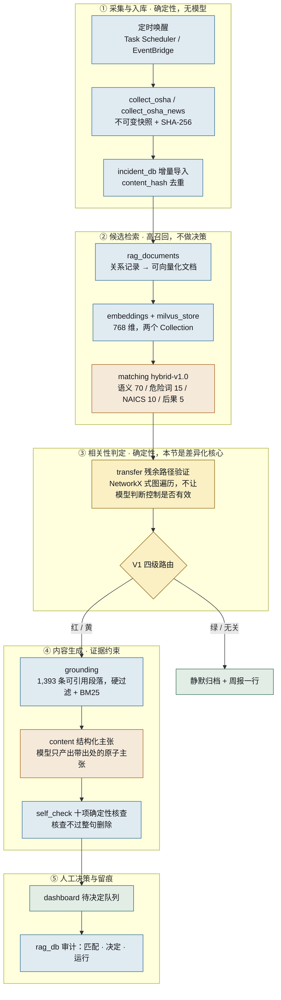

# Hindsight 架构（唯一权威版本）

> **这份文件是准的。** 仓库和团队材料里还有另外三张图，各自的用途见下方
> 「其他几张图分别是什么」一节。有冲突时以本文件为准。
>
> 最后核对：2026-09-08 · 236 项测试全部通过

## 分层



蓝＝确定性代码　橙＝用到模型　黄＝差异化核心　绿＝终点。
**全链路只有两处调用模型**：`matching` 的向量生成，和 `content` 的主张起草。
所有判定都是确定性代码。

## 判定契约

### 残余路径验证（`transfer.py`）

一条危险路径是 `risk_assessments` 的一行：设备 × 任务 × 危险 × 暴露岗位。
判定按固定优先级，第一条命中即生效：

| 序 | 条件 | 结论 |
|---|---|---|
| 1 | `risk_accepted=0`、`status=action_required`，或存在未闭环整改 | ACTIONABLE |
| 2 | 该路径未登记任何控制 | UNKNOWN |
| 3 | 至少一条控制在截止日仍 VERIFIED | NO_ACTIONABLE_TRANSFER |
| 4 | 至少一条控制从未验证过 | UNKNOWN |
| 5 | 其余（全部过期 / 有条件 / 未实施） | ACTIONABLE |

规则 1 压过规则 3 是刻意的：一条工厂已声明未接受的风险，不能被一个验证合格的
防护罩挡回去。**UNKNOWN 永远不等于 False。**

### V1 四级路由（`transfer.route_path`）

| 判定 | 严重度 | 级别 | 去向 |
|---|---|---|---|
| ACTIONABLE | ≥ 4 | 红 | 逐条审批 |
| ACTIONABLE | < 4 | 黄 | 批量确认 |
| UNKNOWN | 任何 | 黄 | 请人过目 |
| NO_ACTIONABLE_TRANSFER | 任何 | 绿 | 静默归档 + 周报一行 |
| 无候选路径 | — | 无关 | 静默归档 |

**UNKNOWN 永不进红。** 高严重且无法判定，正是系统不能装作确定的场合，所以
「高严重 × 低置信强制降黄」写成硬规则，而不是一个需要人去解释的置信分数。

当前虚拟工厂 97 条路径，截止日 2026-09-06 的实际分布：**红 14 · 黄 1 · 绿 82**。

### 内容生成（`learning_pack` / `content` / `self_check`）

模型不写段落，只产出带出处的原子主张。英西双语是同一份主张的两种渲染。
G4 十项核查全部是查表或字符串比对，不含模型判断；核查不过的整句删除，
最多重生成一次，仍填不满必需章节则置 `NEEDS_HUMAN_WRITER`。

细节见 [G1_G4_CONTENT_ZH.md](G1_G4_CONTENT_ZH.md)。

## 相关度分数的定位

```text
relevance = semantic*0.70 + hazard*0.15 + industry*0.10 + consequence*0.05
```

版本 `hybrid-v1.0`，分项与命中词存进 `incident_factory_matches.rationale_json`。

**它是候选检索器，不是决策器。** 分数只影响送进第 ③ 层的候选顺序，不决定
是否提醒人。是否提醒由残余路径验证决定。这条分工是刻意的：权重 70/15/10/5
没有金标准支撑，而召回率是可以验证的。

分数表示「外部事故与本厂已登记风险的相关程度」，不是事故概率、合规结论或
自动行动指令。

## 数据边界

| 层 | 内容 | 位置 |
|---|---|---|
| 原始证据 | OSHA ZIP/CSV/XML/RSS 原文与 SHA-256 | `data/raw/`、`corpus_snapshots` |
| 关系事实 | 105,996 条事故；虚拟工厂 97 条风险评估、66 条控制验证 | `incidents.db`、`factory_zh.db` |
| 接地语料 | 1,393 条可引用段落（29 CFR 8 节 + Fatal Facts 24 篇） | `corpus/grounding.db` |
| 检索 | 只保存可重建的向量 | Milvus 两个 Collection |
| 决策 | 匹配、评分版本、路由级别、人工决定、运行审计 | `rag_db` 各表 |

Agent 可以选择并调用工具，但不能绕过确定性数据写入和人工决定边界。

## Strands 工具

`rag_agent.build_agent()` 注册 9 个：

| 工具 | 层 | 说明 |
|---|---|---|
| `run_daily_surveillance` | ①② | 跑完整采集与匹配流水线 |
| `screen_factory_risk_paths` | ③ | 残余路径验证 + 四级路由，返回筛选结果不返回证书 |
| `collect_grounding_corpus` | ④ | 采集接地语料（一次性） |
| `draft_learning_pack` | ④ | 起草简报与双语班前会，返回审计摘要不返回稿件 |
| `get_pending_decisions` | ⑤ | 待人工决定队列 |
| `record_match_decision` | ⑤ | 记录明确的人工决定 |
| `distribute_learning_pack` | ⑥ | 定向分发（受 A1 守卫保护，无有效令牌直接拒绝） |
| `get_completion_status` | ⑥ | 谁读完了、成绩如何 |
| `get_monday_digest` | ⑥ | 周一摘要，安静的一周也照发 |

其中 `distribute_learning_pack` 被 `authorization.DistributionGuard` 拦在
`BeforeToolCallEvent` 上：守卫直接写 `event.cancel_tool`，工具函数根本不会执行。
这是代码层的拦截，不是提示词层的约束。

## 批准与分发

### 稿件正文是一份存证（`workflow_db.pack_artifacts`）

自检通过时，渲染好的稿件按其内容哈希入库；读出时用**产生该哈希的同一个函数**
重算校验，不相信它被存在哪一列下。这不是仪式：

- 审批令牌用 HMAC 绑定 `pack_content_hash`。若正文哪里都取不到，审批人批准的
  就是一串十六进制，而"人类批准"这条链是空的。
- 取不出正文时**拒绝批准**，且案例状态原地不动——不留下"已批准但没有内容"的记录。
- 正文被改动过，读取直接失败，分发不会发生。

### 批准前的四项强制确认（`dashboard.APPROVAL_CHECKS`）

四项全部勾选、且填写了批准人姓名，"批准并分发"按钮才可用。四项分别对应本项目
声称守住的四条底线：正文被人读过、引用被人抽查过、危险路径与本厂实际作业相符、
有一个具名的人负责。少任何一条，A2 就退化成一次点击。

### 定向分发

默认只发给这条危险路径上真正暴露的岗位，而不是全厂——把焊接事故推给叉车班，
是最容易造成警报疲劳、也最容易被现场关掉的做法。岗位从**调用方传入的**登记册
读取，不读全局配置（跨站点隔离是不可调的内核保证之一）。

若该岗位没有注册任何渠道，返回 `APPROVED_BUT_NO_CHANNEL` 并记录信号，控制台
红色显示。**刻意不退回全厂广播**——广播正是定向分发要避免的那件事。

幂等键 = 案例 + 渠道 + 稿件哈希 + 语言，同一稿件不会重复送达同一渠道。

## 模型接入

三种 provider，环境变量切换：`ollama`（默认）、`openai`、`bedrock`。

`openai` 分支适用于任何 OpenAI 兼容端点（vLLM、SGLang、LM Studio、自建网关）。
它默认走 `content.JsonClaimGenerator`：普通 chat completion + 本地 Pydantic 校验，
**不要求服务端支持严格 `response_format`**。

理由是：真正的保证从来不是"服务端强制了 schema"，而是"我们校验了收到的东西"，
而校验在两条路径上都发生。解析器按括号配对取第一个完整 JSON 对象，能穿过
markdown 围栏、前言与推理块；解析失败带着错误重试一次，绝不成环——上层
`generate_learning_draft` 自己的"最多重生成一次"策略叠在它之上。

## 一条命令

`hindsight-demo` 从数据就绪跑到"有几条待你审批"。前置检查会**真的调用一次模型**，
而不是只看环境变量设没设：只检查配置写法，等于把失败推迟到跑完筛选之后才爆，
那时人已经不知道是哪一步坏了。`--reset` 只清工作流状态，绝不动事故底库与接地语料。

## 其他几张图分别是什么

| 文件 | 是什么 | 什么时候看 |
|---|---|---|
| `HINDSIGHT_WORKFLOW.excalidraw`<br>`hindsight-workflow.png` | 队友画的 7 步线性流水线 | 只描述第 ①② 层，早于 ③④ 层存在。**已被本文件取代** |
| `architecture.mmd` | 15 节点压缩单链 | 提交用架构图的备选版本 |
| `roadmap-44-nodes.svg` | 44 节点 8 层长期蓝图 | README 的「下一阶段」，展示边界想清楚了 |
| Notion《功能工作流 V1.0》 | 29 个功能点、失败兜底与状态机 | 功能验收清单，编号 W/G/A/D/R 与本文件的层对应见下 |

Notion 编号 → 本文件的层：
`W1–W4`→① · `W5a/W5b`→② · `W5c/V1/W6`→③ · `G1–G4`→④ · `A1–A3`→⑤ ·
`D1–D5`、`R1–R4`→尚未实现，见 `roadmap-44-nodes.svg`。
